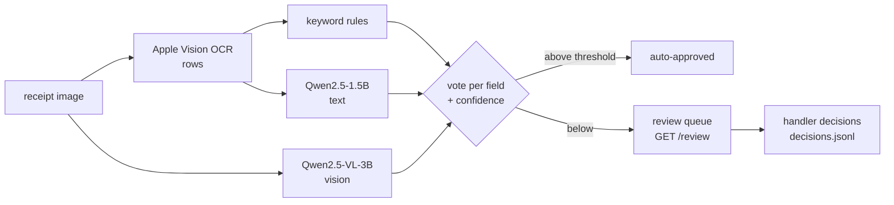

# claims-docai

Insurance claim receipts to structured data: three readers (keyword rules on OCR, a small text model on OCR, a
small vision-language model on the image) vote on each field, a confidence score decides what is auto-approved,
and everything else goes to a human-review queue. Measured on the 100 test receipts of the public CORD v2 dataset.

> Public data only (CORD v2, CC-BY-4.0, Indonesian shop and restaurant receipts). No insurer, claim or customer data.
> Design notes, failure modes and Q&A: [STUDY.md](STUDY.md).

## Problem

Claims handlers in travel, home and motor insurance re-key the amounts from receipts and invoices that customers
upload as proof of loss. It is slow, and a wrong total is paid out. Extraction models make mistakes too, so the
useful question is not "how accurate is the model" but "which fields can skip a human without raising the error
rate, and how much handler time is left".

## Approach

- **Data**: CORD v2 validation (100 receipts) to choose settings, test (100 receipts) scored once. Fields: total,
  subtotal, tax (header fields a handler checks against the policy) and line items (name + price). Amounts are
  compared as integers, so `60.000`, `60,000` and `Rp. 60.000` are the same. A field the receipt does not print is
  correct only if the reader says it is absent.
- **OCR**: Apple Vision on device (`fast` level; `accurate` returned nothing on this Mac), cached in `data/ocr/`.
  The dataset's own word boxes ("gold OCR", text and position only, never its field labels) give an upper bound:
  what the same readers do if OCR were perfect.
- **Readers** (`src/claims_docai/`):
  - `rules.py`: keyword rules over OCR rows (SUBTOTAL / TAX / PB1 / TOTAL, amount at the row's end), the template
    logic claims teams usually start with;
  - `llm.py` text arm: Qwen2.5-1.5B-Instruct (4-bit, MLX, greedy) reads the OCR rows and returns JSON;
  - `llm.py` vision arm: Qwen2.5-VL-3B-Instruct (4-bit, MLX, greedy) reads the receipt image and returns JSON. Pages
    are shrunk to a 1024 px long side; if the model answers only "!!!!" (an fp16 failure on this setup), the same
    page is retried at 896, 768 and 640 px. 3 of 200 pages still failed at every size and are scored as wrong.
  Every model response is recorded in `cassettes/`, so CI replays the evaluation with no GPU or Mac.
- **Routing** (`evaluate.py`): per field, the three real-input readers vote; ties go to the reader with the best
  validation accuracy for that field. Confidence = 0.5 × share of readers agreeing + 0.25 if the amount is printed
  in the OCR + 0.25 if the receipt's arithmetic holds (subtotal + tax = total, items add up, or tax ≈ 10% of
  subtotal). For each precision target (95%, 98%, 99%) the auto-approve threshold is the lowest one that reaches it
  on validation; test is scored once with it. The service runs at 98%, because no threshold reached 99%.
- **Service** (`api.py`): FastAPI. `POST /claims` with an image returns each field with its confidence and a
  `needs_review` flag; `GET /review` is a small HTML queue showing the receipt next to the fields to check;
  corrections are logged to `data/review/decisions.jsonl`.



## Results

<!-- RESULTS:START -->
**Field accuracy on the 100 test receipts** (a field is right if the amount matches, or both say it is absent)

| Arm | Total | Subtotal | Tax | All 3 right | Line items F1 | Median s/receipt |
|---|---|---|---|---|---|---|
| Keyword rules, gold OCR (upper bound) | 80% | 81% | 91% | 64% | 68% | - |
| Qwen2.5-1.5B text, gold OCR (upper bound) | 68% | 68% | 64% | 42% | 72% | 1.83 |
| Keyword rules, Apple Vision OCR | 27% | 51% | 67% | 20% | 32% | - |
| Qwen2.5-1.5B text, Apple Vision OCR | 36% | 45% | 28% | 16% | 30% | 2.79 |
| Qwen2.5-VL-3B, receipt image | 73% | 63% | 41% | 37% | 76% | 10.2 |
| Pipeline: vote of the 3 real-input arms | 74% | 63% | 60% | 32% | 76% | - |

**Review queue** (threshold chosen on validation for each precision target, then applied once to test)

| Target | Split | Threshold | Auto-approved fields | Auto-approved precision | To a handler | Fully auto |
|---|---|---|---|---|---|---|
| 95% | validation | 0.75 | 84/300 (28%) | 95% (80/84) | 216 | 7/100 |
| 95% | test | 0.75 | 69/300 (23%) | 90% (62/69) | 231 | 9/100 |
| 98% | validation | 1.0 | 50/300 (17%) | 98% (49/50) | 250 | 4/100 |
| 98% | test | 1.0 | 35/300 (12%) | 97% (34/35) | 265 | 1/100 |
| 99% | validation | none reached | 0/300 (0%) | - (0/0) | 300 | 0/100 |
| 99% | test | none reached | 0/300 (0%) | - (0/0) | 300 | 0/100 |
<!-- RESULTS:END -->

What the numbers say (100 test receipts, scored once):

- **OCR quality decides everything for the classic pipeline.** The same keyword rules get the total right on 80% of
  receipts with perfect OCR and on 27% with Apple Vision's `fast` OCR, which misreads amounts ("Totsl Rp 39.6",
  "50.QOO"). The 1.5B text model drops from 68% to 36% the same way.
- **A 3B vision-language model reading the image skips most of that loss**: 73% on the total and 76% line-item F1,
  with no OCR at all, at a median 10.2 s per receipt on a laptop. With perfect OCR, simple rules still beat it (80%).
- **Small models invent tax.** The vision model fills `tax` on receipts that print none (precision 39%, recall
  90%). The rules arm is the opposite (precision 100%, recall 20%), so its 67% tax accuracy is mostly correct
  "absent" answers. The vote lands at 60% on tax and 74% on the total (vision model alone: 73%), so voting adds
  little accuracy; its real use is the agreement signal behind the confidence score.
- **The confidence score is precise but covers little.** At the 98% target (threshold 1.0), 35 of 300 test field
  decisions skip a handler and 34 of them are right (97%). 99% was not reachable on validation. A claims team
  would still check most fields by hand; the value here is knowing which few they can skip.

## Run it

```bash
uv sync --extra local                                 # Apple silicon: Apple Vision OCR + MLX models
uv run python -m claims_docai ci                      # what CI runs: replay the evaluation, compare with results/
uv run python -m claims_docai eval && uv run python scripts/tables.py    # rescore and refresh the tables above
uv run python -m claims_docai truth                   # needs data/raw/{validation,test}.parquet from CORD v2
uv run python -m claims_docai record vlm test         # live model run, appends to cassettes/
uv run --extra local uvicorn claims_docai.api:app     # the review service
uv run python -m claims_docai demo test-003           # the walk-through in the demo video
uv run pytest && uv run ruff check .
```

The parquet files are at `huggingface.co/datasets/naver-clova-ix/cord-v2` (`data/test-*.parquet`,
`data/validation-*.parquet`), saved as `data/raw/test.parquet` and `data/raw/validation.parquet`.

## Limitations

- 100 validation and 100 test receipts: the auto-approved slices hold 35 to 84 fields, so a precision of 97% has
  wide error bars (one more mistake moves it by about 3 points).
- CORD receipts are Indonesian shop and restaurant bills, not insurance claim documents. Invoices, medical bills and
  repair estimates have more layouts and more fields; this is a stand-in for the extraction step only.
- Some ground-truth labels disagree with the printed receipt (for example a printed total that is not labelled as
  the total); those count as errors for every reader.
- Apple Vision `accurate` returned no text on this Mac, so only `fast` is measured. A better OCR engine would move
  the rules and text arms a lot.
- Small local models only (1.5B and 3B, 4-bit). No hosted model is measured.
- The review service keeps claims in memory and has no authentication; it is a demo of the routing, not a product.

## Next steps

- Add a stronger OCR engine (PaddleOCR or docTR) as a fourth arm and see whether the rules arm recovers its gold-OCR
  accuracy.
- Calibrate the confidence score (logistic regression on the same features, fitted on validation) instead of fixed
  weights, and report a precision/coverage curve.
- Use handler corrections from `decisions.jsonl` as new labelled data, and re-pick the threshold as they arrive.
- Try a document that looks like a claim: invoices from a public dataset (for example SROIE or FUNSD), with policy
  checks such as "total above the claim limit".

Built with Claude Code as a pair programmer.

Dataset: CORD v2 by NAVER Clova (CC-BY-4.0), https://huggingface.co/datasets/naver-clova-ix/cord-v2.
