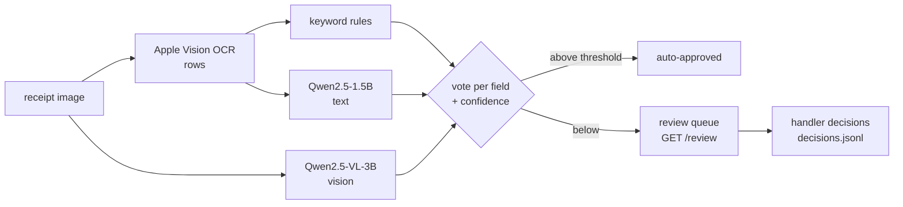

# claims-docai

Insurance claim receipts to structured data: three readers (keyword rules on OCR, a small text model on OCR, a
small vision-language model on the image) vote on each field, a confidence score decides what is auto-approved,
and everything else goes to a human-review queue. Measured on the 100 test receipts of the public CORD v2 dataset.

> Public data only (CORD v2, CC-BY-4.0, Indonesian shop and restaurant receipts). No insurer, claim or customer data.
> Design notes, failure modes and Q&A: [STUDY.md](STUDY.md).

## Problem

Claims handlers in travel, home and motor insurance re-key the amounts from receipts and invoices that customers
upload as proof of loss. It is slow, and a wrong total is paid out. Extraction models make mistakes too, so the
useful question is not "how accurate is the model" but "which fields can skip a human without raising the error
rate, and how much handler time is left".

## Approach

- **Data**: CORD v2 validation (100 receipts) to choose settings, test (100 receipts) scored once. Fields: total,
  subtotal, tax (header fields a handler checks against the policy) and line items (name + price). Amounts are
  compared as integers, so `60.000`, `60,000` and `Rp. 60.000` are the same. A field the receipt does not print is
  correct only if the reader says it is absent.
- **OCR**: Apple Vision on device (`fast` level; `accurate` returned nothing on this Mac), cached in `data/ocr/`.
  The dataset's own word boxes ("gold OCR", text and position only, never its field labels) give an upper bound:
  what the same readers do if OCR were perfect.
- **Readers** (`src/claims_docai/`):
  - `rules.py`: keyword rules over OCR rows (SUBTOTAL / TAX / PB1 / TOTAL, amount at the row's end), the template
    logic claims teams usually start with;
  - `llm.py` text arm: Qwen2.5-1.5B-Instruct (4-bit, MLX, greedy) reads the OCR rows and returns JSON;
  - `llm.py` vision arm: Qwen2.5-VL-3B-Instruct (4-bit, MLX, greedy) reads the receipt image and returns JSON.
  Every model response is recorded in `cassettes/`, so CI replays the evaluation with no GPU or Mac.
- **Routing** (`evaluate.py`): per field, the three real-input readers vote; ties go to the reader with the best
  validation accuracy for that field. Confidence = 0.5 × share of readers agreeing + 0.25 if the amount is printed
  in the OCR + 0.25 if the receipt's arithmetic holds (subtotal + tax = total, items add up, or tax ≈ 10% of
  subtotal). The auto-approve threshold is the lowest one that reaches 99% precision on validation.
- **Service** (`api.py`): FastAPI. `POST /claims` with an image returns each field with its confidence and a
  `needs_review` flag; `GET /review` is a small HTML queue showing the receipt next to the fields to check;
  corrections are logged to `data/review/decisions.jsonl`.



## Results

<!-- RESULTS:START -->
<!-- RESULTS:END -->

FINDINGS

## Run it

```bash
uv sync --extra local                                 # Apple silicon: Apple Vision OCR + MLX models
uv run python -m claims_docai ci                      # what CI runs: replay the evaluation, compare with results/
uv run python -m claims_docai eval && uv run python scripts/tables.py    # rescore and refresh the tables above
uv run python -m claims_docai truth                   # needs data/raw/{validation,test}.parquet from CORD v2
uv run python -m claims_docai record vlm test         # live model run, appends to cassettes/
uv run --extra local uvicorn claims_docai.api:app     # the review service
uv run python -m claims_docai demo test-003           # the walk-through in the demo video
uv run pytest && uv run ruff check .
```

The parquet files are at `huggingface.co/datasets/naver-clova-ix/cord-v2` (`data/test-*.parquet`,
`data/validation-*.parquet`), saved as `data/raw/test.parquet` and `data/raw/validation.parquet`.

## Limitations

LIMITATIONS

## Next steps

NEXT

Built with Claude Code as a pair programmer.

Dataset: CORD v2 by NAVER Clova (CC-BY-4.0), https://huggingface.co/datasets/naver-clova-ix/cord-v2.
